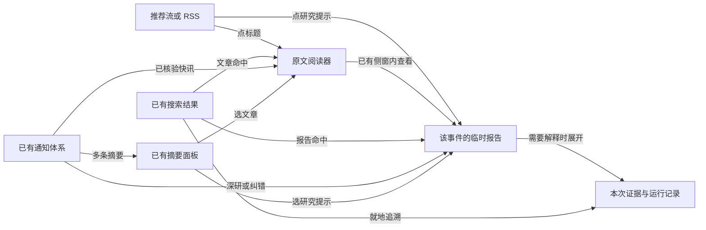
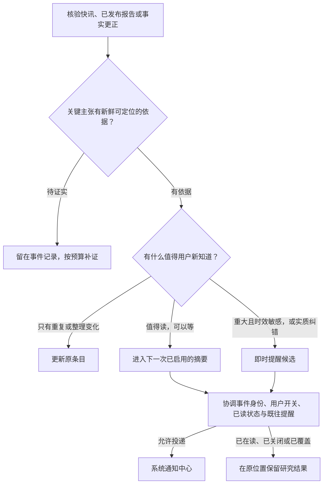

# NewsBar 阅读增强、深度研究与通知方案

**产品方案 v1.0 · 2026-11-18 · 基于 NewsBar v3.2.0 · 待实施**

读者先被推荐或 RSS 里的新闻吸引，再决定是否多看一层。另一条同样重要的路径是：一件值得知道的事已经核清，NewsBar 主动提醒，读者点开就能看到原文、结论或更正。两条路径落在同一事件上，共用同一份证据与报告。

## 1. 阅读路径

菜单栏和 Dashboard 沿用现有入口、默认页面、推荐排序、RSS 顺序、搜索范围与快捷键。点标题或封面仍读原文。新能力落在已有的文章元信息、阅读器侧窗、搜索结果、研究工作台和通知中。后台候选只在需要追溯时出现。

| 接触点 | 显示什么 | 用户操作的结果 |
|---|---|---|
| 推荐卡片、RSS 行 | 可靠关联到运行中的任务或已发布报告时，在来源和时间旁显示一个「研究中」或「有深研」；普通文章沿用原来的密度 | 点提示打开报告；角标变化保持当前行高、瀑布流位置和推荐分数。「有深研」也可以指一篇驳斥原报道的报告 |
| 阅读器侧窗 | 在已有「概览」里提供与当前文章有关的一句结论、截至时间和依据；本地报告可独立于 AI 页面概览显示 | 侧窗跟随当前页面；临时报告固定到选中的事件。快速切换标签或跳转网页时，旧请求的结果只能更新原页面 |
| 已有搜索 | 当前流的筛选框继续筛当前流。阅读器本地／网页／AI 搜索保留各自的提交语义。完整标题优先显示原文，同一事件的报告版本和转载可展开 | 结果可就地展开「研究记录」。侧窗搜索可打开临时报告；若宿主本身已是弹窗，就在同一容器内切换内容并提供返回，恢复搜索词、选中项和滚动位置 |
| 现有研究工作台 | 主动打开时，按值得跟进的事件组织，优先出现重要进展、实质纠错和正在深研的项目。提供跟踪、归档和查找全部线索 | 与搜索共用事件详情、证据和运行记录。批量管理留在这里，日常阅读和查看报告都可原地完成 |
| 临时报告 | 首屏显示研究问题、当前结论、仍待确认和最后核验时间。结论旁可展开来源、原文引句和版本变化 | 同一事件复用窗口。点关闭或在报告获焦时按 `⌘W` 关闭，`Esc` 先退当前展开层，再回原卡片、标签或查询。新版本就绪时显式提示，保留读者正在看的段落 |

**关联要能解释。** 优先使用文章身份、规范化 URL 或已确认的事件成员关系。标题相似、出现同一机构、仅被引作背景材料，只用于找候选。点角标和查看运行记录单独记作研究操作，避免误计为阅读原文或强化个人兴趣。阅读器现有匹配包含标题指纹回退，不能直接把每次匹配都显示为面向读者的研究标记。[当前页面匹配](../../../Sources/NewsBar/Views/Dashboard/ReaderResearchPanelModel.swift) · [研究记录匹配](../../../Sources/NewsBar/Services/Research/ResearchStore.swift)

## 2. 先筛重要性与兴趣，再决定研究深度

1. **接收增量。** 复用本轮推荐、热榜和已启用 RSS 的新增或变化条目。本机先过滤过期、硬屏蔽、排除、重复 URL 和同源转载，按现实事件归并。先核影响面大、权威机构有实质发布、或既有结论出现关键变化的公共要闻；其次处理明确关注和本机兴趣。两路都命中只占一席，低热度的重大新闻也有入选路径。
2. **用脚本核最小事实。** 从已有正文、缓存、原始公告或结构化数据核对发布者、时间、单位、适用范围及修订。公告可证明某机构发布了某项安排；实施效果和外界损失等延伸判断另找依据。搜索摘要和模型回答只提供线索。
3. **有具体缺口才补搜。** 写下尚待回答的问题，优先取得对应一手材料。数值、日期或版本对照已能回答时，附出处生成核验快讯。热度高但证据不足的事件优先复查，保持待核验。
4. **必要时才交给 Agent。** 有现实影响或明确兴趣价值、有实质新事实或证据冲突，并且继续查证有望回答一个具体问题时，才进入深研。输入包括已有证据、来源关系、前次结论和缺口。Agent 对照不同材料，逐项给出主张、引句、依据与不确定性。自动关键词、爆款和兴趣候选共用此门槛；用户明确发起研究可直接排队，沿用费用与联网设置。

例如，十家转载同一份时刻表，本机归为一个来源；官方表格明确试行日期，可直接发快讯；原公告与传播中的“全线延时”范围不一致，才值得让 Agent 对照不同版本和区段。现有系统已有候选归并、选题判断和自动研究限流，可以从这些位置收紧准入。[候选构建](../../../Sources/NewsBar/Services/Research/ResearchCandidateBuilder.swift) · [自动选题](../../../Sources/NewsBar/Services/Research/ResearchTriage.swift) · [自动研究限流](../../../Sources/NewsBar/Services/Research/ResearchAutomationPolicy.swift)

## 3. 可选的动态研究进展

「显示研究进展」默认折叠，记住用户选择。文章被打开时只读取本地关联。打开正在生成的报告时，先显示上次核验版本或“研究中”，再按需订阅同一任务。

| 任务状态 | 展开后可见的输出 |
|---|---|
| 找来源、读资料 | “已找到运营方公告”“正在核对东段时刻表”。展示真实阶段、已读来源和已完成计数 |
| 已完成某项核验 | 逐段展示能够定位到原文的阶段性发现，标明其适用范围。其余问题保留待确认 |
| 暂缓或部分完成 | 说明哪个来源受限、哪一项仍无法核验；上一份有效报告和它的时间继续可读 |
| 最终发布 | 校验报告引用，保存版本及其与上版的实质变化，再更新角标、正式搜索结果和通知候选 |

界面订阅现有任务产生的阶段与计数，关闭即解绑；关闭窗口与取消任务是两个独立动作。展示用短句可由阶段和数据生成。草稿或临时计数只进入当前报告，避免挤占通知、反复索引或为展示进度额外调用模型。[任务阶段与快照](../../../Sources/NewsBar/Models/ResearchRecord.swift) · [研究管线](../../../Sources/NewsBar/Services/Research/ResearchPipeline.swift)

## 4. 通知如何判断一件事值得打扰

对每个候选依次回答四个问题。**准确度决定能说什么；公共影响、爆款传播速度与用户相关性决定有多值得知道；研究深度决定点开能多读到什么；时效与事实变化决定何时提醒。** 热度突升先加快核验。具有深度价值的非热点也可以推送，例如用户跟踪的政策出现实质修订。

| 情况 | 证据与新闻价值 | 默认送达和点击落点 |
|---|---|---|
| 爆款线索 | 热度突升，只有截图、匿名转述或同源复制；关键说法仍冲突 | 后台优先核验。研究人员可追溯原因，读者不会收到把传闻写成事实的横幅 |
| 已核验快讯 | 有可定位的原始发布，关键事实明确；或多个可区分的发布者提供与该主张相关的证据 | 普通进展进已开启的小时／每日摘要；重大且等待会降低价值时，以事件提醒即时送达。点单条读原文，可就地看核验依据 |
| 首份有价值的深研 | 报告可读、关键引文已验，确实回答了一个新问题；公共要闻和个人关注均可入选 | 加入已开启的摘要并标记「有深研」。若未启用摘要而已启用研究提醒，则以单条研究通知送达。已核验结论时效性高时可立即提醒；点击直接开该事件报告 |
| 快讯之后出报告 | 同一事件；报告可能只是补背景，也可能改变读者对范围、后果或行动时间的理解 | 只补背景时更新原条目，在下一次已启用摘要中附报告；无摘要且用户只开研究提醒时，首次合格报告可发一次。实质变化且时效敏感才再即时提醒，打开后先呈现“本次变化” |
| 对此前提醒的实质更正 | 能识别旧主张、纠正它的新证据及具体差异；来源新增或文案润色不会触发 | 原通知可对应到本机曾提交的提醒时，在用户仍允许的相应通道中优先发更正，并标记历史版本。点击直接定位旧说法、新结论及原文依据 |
| 失败、限流、研究中或只改措辞 | 没有新增可发布结论 | 在报告内显示进度或原因。即使已有多次重试，也只维护同一条任务记录 |

**首发门槛的处理。** v3.2.0 事件监测首次提醒要求核心一致、有新鲜证据且至少三个可计数发布者。首版保留原路径的门槛。另设一个范围窄的“原始发布”资格，用于身份和原文均可核实的官方公告、结构化数据及其明确字段；通知可写“运营方公布周末时刻表”，其推断出来的效果仍走常规核验。来源数、域名数和独立采访数分开展示。[现有事件通知策略](../../../Sources/NewsBar/Services/Events/NewsEventNotificationPolicy.swift)

**投递时的取舍。** 同一变化同时生成快讯和报告时，选择信息最完整的合格通知一次送达，给读者保留原文和深研两个阅读选择。多个事件争同一个摘要名额时，先处理此前已推结论的更正，再考虑下次摘要前会影响读者判断的变化，其次是首份有实质新结论的报告。同级先看公共影响，再看明确关注与新鲜度。用户只开每日摘要且单次只收三条时，发送最值得读的三条，其余保留在应用内；日目标不会扩大用户设置的条数。

### 用户开关、文案与阅读落点

- **尊重现有选择。** 自动研究、研究／爆款提醒、事件提醒、小时摘要和每日摘要各管自己的通道。首次深研随摘要投递的前提是允许研究提醒且至少一个摘要通道开启；只启用常规摘要时，原来的新闻仍可正常入选，用户点开后可看到本地已有报告。关闭一个通道后不得通过另一个通道补发同一种提醒。研究、跟踪和阅读可在通知权限关闭时继续。
- **关注时机。** 正在阅读同一事件且窗口可见时，只在原处轻提示“研究已就绪”或“结论有更正”。读别的文章时按正常优先级。尊重 macOS 通知权限、专注模式、声音和预览选择，系统接受请求只说明已提交。不要据此标记读者已看过；阅读与已读动作沿用现有设置。[现有提醒设置](../../../Sources/NewsBar/Views/Settings/ReminderTab.swift) · [事件开关](../../../Sources/NewsBar/Views/Settings/EventMonitorNotificationSettingsSection.swift) · [Apple 通知设计指南](https://developer.apple.com/design/human-interface-guidelines/notifications)
- **锁屏采用保守预览。** 研究通知默认给出可安全显示的主题和“有新的核验结果”；敏感主题用通用标题。详细预览须由用户明确开启，再显示一条已核验、限定范围的结论。当前设置已有“通知摘要”字段且缺省为真，现行发送器却固定使用通用正文。升级时维持原先实际可见范围，不能将旧默认值解释为对新增锁屏披露的同意。[摘要设置](../../../Sources/NewsBar/Views/Settings/ResearchAutomationSection.swift) · [现有通知正文](../../../Sources/NewsBar/Services/NotificationService.swift)
- **点开即抵达。** 单条快讯进原文，多条进原有摘要面板，研究进对应报告，更正进对应差异。通知点击、查看证据、标记已读均使用本地记录。冷启动先恢复目标，旧通知沿用已有标识解析；若记录已删除，提示“该报告已移除”，有有效原文则提供打开原文。若通知版本已被纠正，优先提示当前结论，保留历史版本可查。摘要沿用每次 1～3 条的用户配置和原有单条／多条点击行为。[摘要模型](../../../Sources/NewsBar/Models/NotificationDigest.swift) · [现有点击路由](../../../Sources/NewsBar/Services/NotificationClickRouter.swift)

### 用一个例子验收整条链路

| 时刻与证据（虚构） | 用户体验 |
|---|---|
| 09:00，“海湾线全线延时”冲上热榜，八篇转载源自同一张图 | 优先核验，零条系统通知 |
| 09:15，运营方确认周末夜班试行，区段待核对 | 能确认的事实进入摘要候选。若已开启事件提醒且出行时效满足即时门槛，发一次快讯；点击直接看公告 |
| 09:40，报告对照时刻表，确认本轮仅覆盖东段，首版列明周五、周六运行 | 原文章出现「有深研」。如果此前只推送“试行”，按下一次摘要是否会错过出行决策来选择即时送达或并入摘要；打开报告直接看到东段范围和时刻表依据 |
| 10:00，用户已从通知打开报告，下一次摘要即将发出 | 同一版本跳过重复的研究提醒，摘要空间留给其他合格事件。当天仍只计一个不同事件；实际发过的横幅分别计数 |
| 11:10，运营方勘误，首周只有周六开行 | 若此前提交的提醒包含旧日期，优先送达更正；点开定位“周五、周六 → 首周仅周六”和勘误依据。此前只见过通用研究提醒的用户，在报告首屏可见相同更正 |

**通知文案示例。** 默认研究预览可显示「海湾线夜班试行」和「研究已就绪，可查看核验依据」。若用户主动开启详细预览，首份报告可显示「试行范围已核清」和「对照公告与时刻表，夜班仅覆盖东段」。更正可显示「海湾线夜班安排有更正」；允许显示详情时再附「首周仅周六开行，运营方已修正此前公布的日期」。三种文案都在打开后落到相应事实与证据。

## 5. 通知协调、性能与恢复

**统一投递判断，保留原有发送与路由。** 小时摘要、每日摘要、事件进展和研究完成在形成通知前，共用同一份事件投递记录。微博关注提醒继续走原有规则；注册系统通知类别时保留全部现存动作。v3.2.0 已能协调事件与研究完成，摘要有单独的发送路径。[事件与研究协调器](../../../Sources/NewsBar/Services/Workspace/WorkspaceNotificationCoordinator.swift) · [系统通知发送器](../../../Sources/NewsBar/Services/NotificationService.swift)

- **按事件和事实变化去重。** 合并依据为稳定事件身份、关键主张的前后变化、报告版本和通知原因。标题、来源数量或模型改写不能单独构成新提醒。待发摘要可升级到最新版本；相同事实已即时提交时，从待发摘要移除重复提醒。小时和每日摘要命中同一事件时，只有尚未覆盖的新进展才有再次占位资格。为旧数据保留可解析的文章、事件和报告 ID。
- **区分排队、系统已接受、提交失败、结果未知和用户已读。** 投递前保存唯一意图和稳定请求标识，系统接受后才确认。明确失败可在时效、通道与预算仍有效时有限重试；崩溃后先核对系统待发／已送达记录，结果未知时不盲发第二条横幅。每次实际投递前复查静音、权限、归档与版本。每日重复触发器维持原调度，内容过期时沿用中性摘要模板，避免旧研究反复被当作今日新结论。[现有事件发送次序](../../../Sources/NewsBar/Services/Events/NewsEventController.swift) · [既有研究提交路径](../../../Sources/NewsBar/Services/Workspace/WorkspaceAutomationService.swift)
- **把进度更新与发布更新分流。** 一次刷新只处理增量，后台自动深研同时至多一个；同事件多入口共享任务。进度只唤醒正在看该报告的视图，发布、实质更正、归档和删除才更新相关检索记录。角标批量查本地索引，索引重建放到阅读路径之外；清除历史后的旧回调不能复活报告、角标和待发通知。[现有搜索索引重建](../../../Sources/NewsBar/Services/Workspace/WorkspaceSearchService.swift) · [研究历史设计](../../research-center.zh-CN.md)

## 6. 量、免费来源与开销

普通日每小时择优核验 **1～2 个事件**，没有合格候选可以为零。每天通常 **5～6 个不同事件值得送达**，活跃日约 **10 个**，其中通常 **2～3 个值得深研**。这些是质量和频率的参考值；事件数、研究篇数、摘要数、实际横幅数及已读数分别统计。突发时建议以两小时为窗口，多个独立重大事件或关键更正可临时额外深研最多两项，到期重新评估。费用硬上限继续生效；纠错优先于尚未投递的普通条目。

| 开销档 | 自动外部搜索参考上限 | 用途 |
|---|---:|---|
| 节省 | 8 次／日 | 已有正文和一手源优先，把外部调用留给关键缺口 |
| 均衡（建议初值） | 20 次／日 | 起步分配为快讯补证 8 次、深研 8 次、突发 4 次，可在额度内调剂 |
| 增强 | 40 次／日 | 需要更多交叉核验时选用；付费需明确日、月金额上限 |

上述次数只约束自动任务。每家服务商先按本期余额和剩余天数估算今天可用额度，留出手动查询份额后，再取可用自动额度与所选档位上限的较小值。每次实际搜索分发和故障切换分别计数，缓存命中免费。对抓页、服务商 credits、模型调用和金额另记账，展示本地估算与可取得的服务商用量。匿名额度未公开时采用保守本地限额；遇到限流按冷却退避。无模型时仍提供可追溯的已有资料和确定性核验快讯。

| 顺序 | 来源与接入决策 |
|---|---|
| 已有正文与免费一手源 | 复用用户已启用 RSS 的条件请求与缓存。国家统计局 RSS、香港政府新闻公报、USGS 地震 GeoJSON 按主题匹配，作为后台证据目录，不替用户修改订阅。公共数据也需标明来源、发布时间和修订时间。[国家统计局](https://www.stats.gov.cn/wzgl/rss/) · [香港政府新闻公报](https://data.gov.hk/sc-data/dataset/hk-isd-gnmis-gnmis) · [USGS](https://earthquake.usgs.gov/earthquakes/feed/v1.0/geojson.php) |
| 已有免 Key 搜索 | Tavily 和 Firecrawl 均已有免 Key 搜索适配。先选一家，遇到证据缺口或不可用时再按已启用配置备援。Tavily 匿名轻量额度与注册后的月额度分开；Firecrawl 匿名路径按 IP 和用量限流，远端抓正文另按当前策略与授权处理。[Tavily](https://docs.tavily.com/documentation/keyless) · [Firecrawl](https://docs.firecrawl.dev/rate-limits) |
| 覆盖不足时再扩展 | Parallel 托管 MCP 的免账号轻量搜索／取页适合优先评估；Exa 托管 MCP 作备选，GDELT 用于发现国际报道，证据回到原始发布者。由应用适配，用户无需安装 MCP。按中文相关性、一手来源命中率、延迟和限流率决定是否进入日常路由。[Parallel](https://parallel.ai/mcp) · [Exa](https://exa.ai/docs/get-started/exa-mcp) · [GDELT](https://blog.gdeltproject.org/gdelt-doc-2-0-api-debuts/) |

服务商能力按 2026-11-18 所见官方资料记录。无 Key 搜索、模型生成、地区网络可达性是三项独立能力。实施时须实测匿名通道及中文源，随后再标记“可用”。外部查询仅携带当前事件所需的公开信息，兴趣画像与阅读轨迹在本机使用。

## 7. 交付次序与验收

| 阶段 | 首要验收 |
|---|---|
| 1 · 阅读增强 | 同一输入、同一兴趣快照下，增强开关两侧的推荐顺序、RSS 顺序、标题点击和返回一致。RSS 第 30 条打开报告并关闭后，可继续读第 31 条。关联错误、无图卡、窄窗、两套主题、键盘及 VoiceOver 均覆盖 |
| 2 · 筛选、核验与进展 | 回放安静日、普通日和突发日。弱热度但高影响的一手消息能入选，同源复制归为一个来源，普通刷流新增的研究搜索与模型调用为零。开关动态展示所得报告一致、调用数一致；离线或限流可读上一版 |
| 3 · 研究主动送达 | 首份有价值的报告在已启用的通道可达；核验不足的爆款不触发事实型提醒。模拟快讯与报告先后倒置、摘要与即时通知并发、用户正在读、通道关闭、系统拒绝、重启和旧通知点击。每次提醒的依据与落点可追溯，同一变化只有一次有声打扰资格 |
| 4 · 扩充来源与调优 | 在现有来源上先测取得一手依据的比例、每个已核验事件的搜索与模型成本、重复通知数、漏掉的重大新闻以及通知打开后找到正确结论的比例。增加服务商前后用同一批样本对照；候选数或点击率不单独作为质量目标 |

发布时让阅读展示、自动深研和研究通知分别可关闭。回退任一层保留已有原文、关注设置、报告版本和证据；暂停新增研究通知时，只撤销该层拥有的待发请求，保留用户原来的定时摘要与其他关注提醒。本文只确定产品方案，数值为首轮回放和可用性验证的起点。
